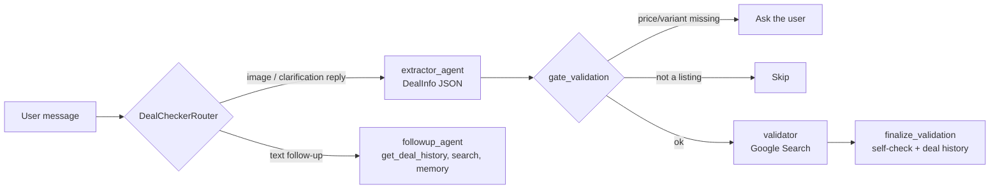

# DealChecker

Checks second-hand marketplace listings (eBay, Facebook Marketplace, Vinted, Blocket, …)
from screenshots: reads the listing, compares it with the real product and current
prices via Google Search, and gives a verdict (**Good deal / Fair / Overpriced /
Suspicious**). Follow-up questions (offers, what to inspect, comparing past deals) are
answered from the stored results. Built with [ADK](https://google.github.io/adk-docs/)
and Gemini.

## How it works



| Piece | Where |
|---|---|
| Agents, router, callbacks | [`src/deal_checker/agent.py`](src/deal_checker/agent.py) |
| Instructions | [`src/deal_checker/prompts.py`](src/deal_checker/prompts.py) |
| Tools (`get_deal_history`) | [`src/deal_checker/tools.py`](src/deal_checker/tools.py) |
| Guardrails (input policy, Model Armor, verdict self-check, safety settings) | [`src/deal_checker/guardrails.py`](src/deal_checker/guardrails.py) |
| Structured logging, tracing, observability plugin | [`src/deal_checker/observability.py`](src/deal_checker/observability.py) |
| CLI error guidance | [`src/deal_checker/errors.py`](src/deal_checker/errors.py) |
| CLI | [`src/main.py`](src/main.py) |

Models: `gemini-3.8-flash` for the check, `gemini-3.5-flash-lite` for follow-ups.

## Setup

Requires [uv](https://docs.astral.sh/uv/) and Python 3.13.

```bash
uv sync
cp .env.example .env      # then set GOOGLE_API_KEY
```

That is enough for a local run (sessions in `.adk/sessions.db`, no cloud services).

### Optional: Google Cloud features

All idempotent; see each script's docstring.

```bash
gcloud auth application-default login
bash scripts/enable_apis.sh <project-id>                                   # required APIs
uv run scripts/create_agent_engine.py --project <id> --location <region>          # sessions + Memory Bank
uv run scripts/create_model_armor_templates.py --project <id> --location <region> # Model Armor
```

Each script prints the values to put in `.env` (see [`.env.example`](.env.example)).
Set `LOG_TO_CLOUD=true` / `TRACE_TO_CLOUD=true` for Cloud Logging / Cloud Trace.

## Usage

```bash
uv run src/main.py screenshots/sample.png                     # check a listing
uv run src/main.py photo1.png photo2.jpg                      # several photos of one listing
uv run src/main.py --resume -q "What should I offer?"         # follow-up in the latest session
uv run src/main.py -q "Which of my checked deals is best?"    # question about past deals
```

If the price is missing, DealChecker pauses and asks; answer with
`uv run src/main.py --resume -q "It's £280"`. Errors print a fix; add `--debug` for the
traceback.

Web UI: `bash scripts/web.sh`, then open http://127.0.0.1:8000. It loads `.env` before
`adk web` starts and passes the Agent Engine session/memory URIs (plain `adk web src`
ignores them and keeps sessions in memory).

## Tests

```bash
uv run pytest                                                           # offline unit tests, free
uv run python tests/eval/run_eval.py --baseline tests/eval/baseline.json # golden-dataset eval
```

The eval runs the real app (Gemini, Google Search, Model Armor; costs a few cents) on
[`tests/eval/golden.json`](tests/eval/golden.json) with code-graded checks plus a
Flash-Lite judge, and exits non-zero on failure. Options: `--case`, `--repeat N`,
`--no-judge`. Results go to `tests/eval/results/` (git-ignored).

### Eval images

Listing screenshots are not included in the repo (they show real third-party
listings). To run the eval, save a marketplace listing screenshot as
`screenshots/sample.png` and generate the fixtures:

```bash
uv run python tests/eval/make_fixtures.py   # writes tests/eval/fixtures/*.png
```

The golden expectations (price ranges, verdicts) were written for a used Sage Barista
Express listed at £320, with the price in the top-right corner. For another product or
layout, adjust `tests/eval/golden.json` and the price area in `make_fixtures.py`.

## License

[Apache 2.0](LICENSE)
